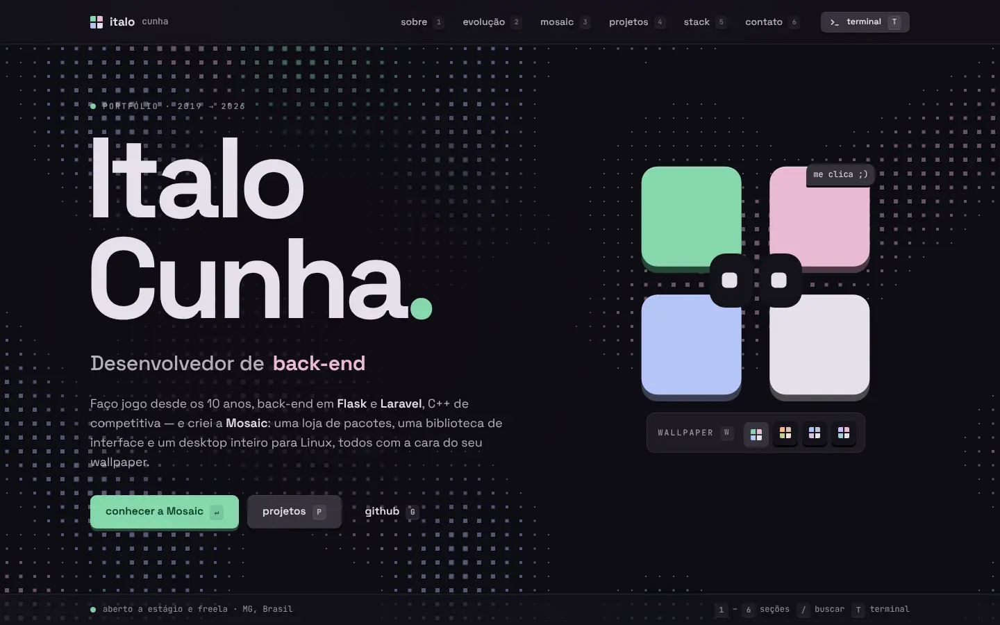
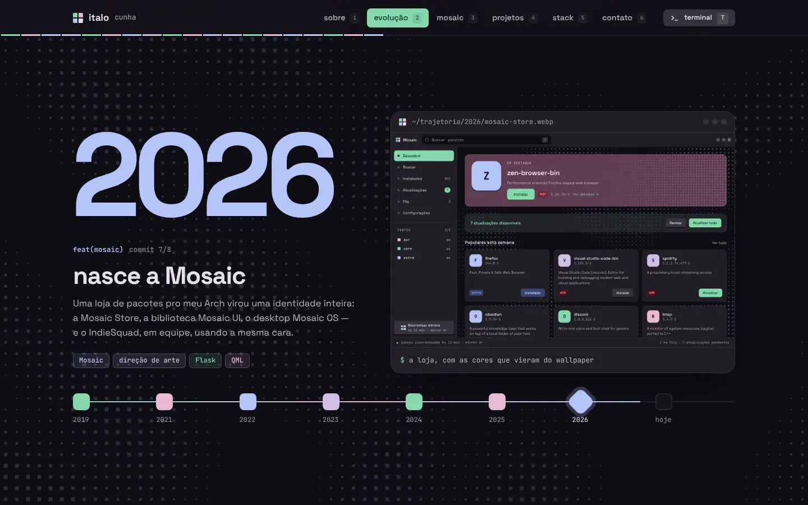
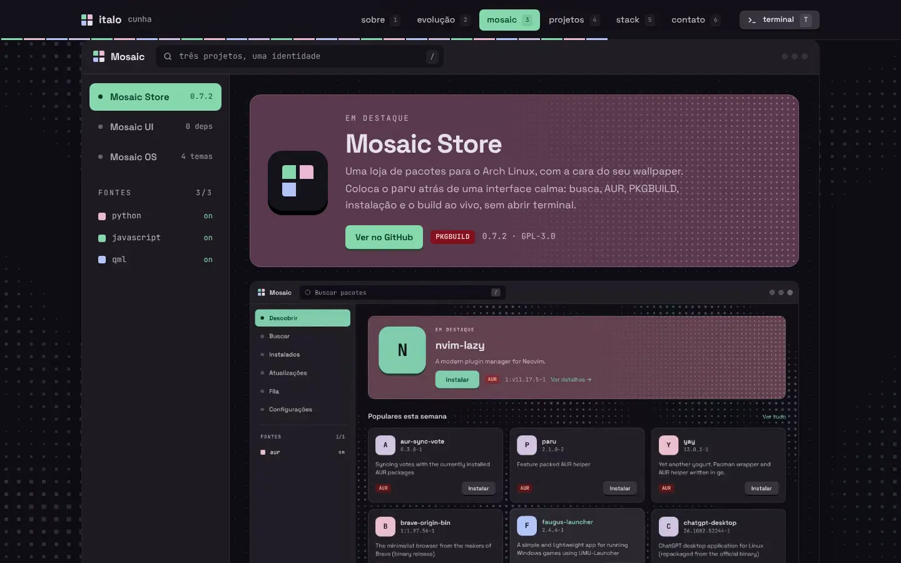
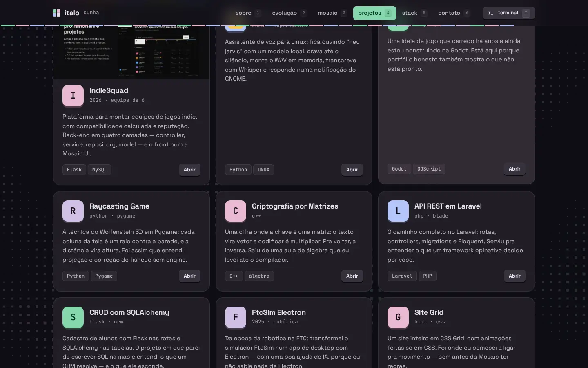
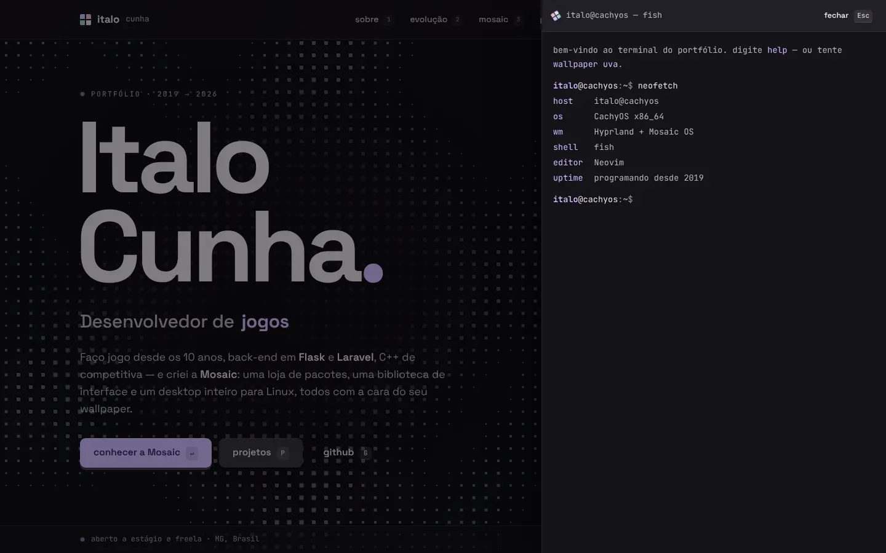
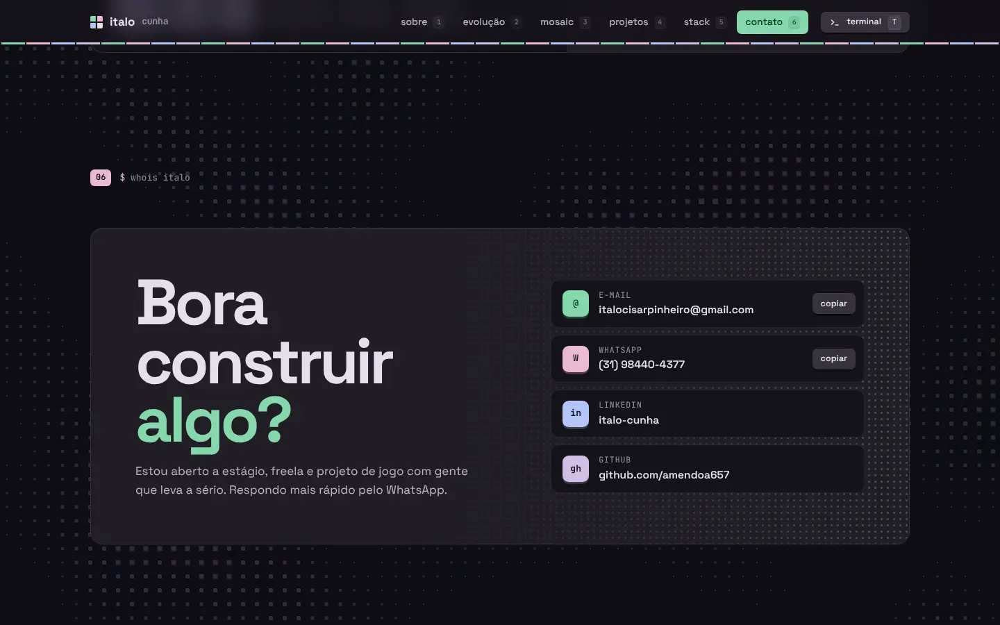

<div align="center">

# Portfólio — Italo Cunha

### Jogos, back-end e a Mosaic — num site com a cara do seu wallpaper.



🌐 **Versão publicada:** [portifolio.italocisarpinheiro.workers.dev](https://portifolio.italocisarpinheiro.workers.dev/)

<p>
  <a href="#a-ideia">A ideia</a> ·
  <a href="#telas">Telas</a> ·
  <a href="#as-animações">Animações</a> ·
  <a href="#atalhos">Atalhos</a> ·
  <a href="#rodando-localmente">Rodando localmente</a>
</p>

</div>

> Escrito à mão em **HTML, CSS e JavaScript**, sem framework e sem build. A estética é a da **[Mosaic UI](https://github.com/amendoa657/mosaicStore/tree/main/mosaic-ui)**, a identidade visual que eu criei para a Mosaic Store e o Mosaic OS.

## A ideia

A versão anterior era um terminal âmbar. Esta é a mesma pessoa, depois da Mosaic: o site inteiro segue as regras da identidade — **calma, rápida e legível**.

- **Blocos chapados** nas cores do wallpaper e **teclas que afundam** de verdade (no clique e no teclado);
- um **campo de pontos** andando atrás de tudo, com uma lente que segue o mouse;
- a **onda de pixels** em toda troca de tela: navegar, trocar de projeto, avançar na linha do tempo;
- **o wallpaper troca as cores**: clique no mascote (ou aperte <kbd>W</kbd>) e o site se repinta numa onda;
- curvas fortes e curtas, nada quica sem motivo, e **movimento reduzido é respeitado**.

## Telas

<table>
  <tr>
    <td width="50%">
      <strong>Evolução</strong><br>
      <sub>A linha do tempo fica presa na tela e avança com a rolagem, de 2019 até hoje. O ano rola, o texto entra em cascata e a imagem se revela numa onda de pixels.</sub><br><br>
      
    </td>
    <td width="50%">
      <strong>Mosaic</strong><br>
      <sub>Uma janela de app da Mosaic com Store, UI e OS na lateral. A pílula desliza e o painel novo nasce numa onda que sai do clique.</sub><br><br>
      
    </td>
  </tr>
  <tr>
    <td>
      <strong>Projetos</strong><br>
      <sub>Cada projeto é um "pacote", como na loja. Busca com <kbd>/</kbd> e filtro por área.</sub><br><br>
      
    </td>
    <td>
      <strong>Terminal</strong><br>
      <sub>Um shell num painel lateral (<kbd>T</kbd>), com histórico, Tab e um <code>wallpaper</code> que troca as cores do site.</sub><br><br>
      
    </td>
  </tr>
  <tr>
    <td colspan="2">
      <strong>Contato</strong><br>
      <sub>E-mail e telefone com cópia e aviso flutuante.</sub><br><br>
      
    </td>
  </tr>
</table>

## As animações

| O quê | Como |
| --- | --- |
| **Abertura** | Como a da Mosaic Store: a janela nasce coberta com a marca girando um quarto por vez, e a página se revela numa onda que sai dela. Uma vez por sessão; clique ou tecla pula. |
| **Nome em pixels** | O texto é desenhado num canvas, amostrado numa grade, e cada célula voa até o lugar na cor de uma das ondas do campo. Os títulos das seções fazem o mesmo quando entram na tela. |
| **Campo de pontos** | A mesma conta do `pixels-worker.js` da Mosaic UI: três ondas, uma por cor do tema; em cada célula vence a mais forte. Trigonometria por linha e por coluna (soma de arcos) e só as células que mudaram são redesenhadas. 30 qps parado, taxa da tela com o mouse mexendo, para quando a aba some. |
| **Onda de pixels** | Revelar (a área nasce coberta e cada célula encolhe a partir da origem) e cobrir (o contrário). Usada na navegação, na troca de wallpaper, na janela da Mosaic, na linha do tempo e nos temas do Mosaic OS. |
| **Mascote** | A marca viva do Mosaic OS: quatro blocos com olhos que seguem o mouse, piscam, e giram um quarto de volta trocando o wallpaper. |
| **Teclas** | Borda de baixo mais escura que some ao apertar. Os atalhos de teclado afundam a tecla da tela antes de agir. |

## Atalhos

| Tecla | O que faz |
| --- | --- |
| <kbd>1</kbd>–<kbd>6</kbd> | vai para a seção, numa onda de pixels |
| <kbd>Enter</kbd> / <kbd>P</kbd> / <kbd>G</kbd> | Mosaic / projetos / GitHub |
| <kbd>W</kbd> | troca o wallpaper (as cores do site) |
| <kbd>/</kbd> | busca nos projetos |
| <kbd>T</kbd> | abre o terminal |
| <kbd>A</kbd> <kbd>S</kbd> <kbd>D</kbd> | aperta as teclas do pilar da Mosaic |
| <kbd>←</kbd> <kbd>→</kbd> | anda na linha do tempo (quando ela está na tela) |

## Estrutura

```text
.
├── index.html            # conteúdo e estrutura
├── style.css             # tokens da Mosaic UI, componentes, layout e movimento
├── fontes/               # Space Grotesk e JetBrains Mono (SIL OFL 1.1)
├── img/                  # imagens da linha do tempo
├── midia/                # vídeos e capturas da Mosaic, do Mosaic OS e dos projetos
├── assetsReadme/         # capturas deste README
└── js/
    ├── pixels.js         # campo de pontos e onda de pixels
    ├── tema.js           # paletas ("wallpaper") e a troca em onda
    ├── pixelTexto.js     # títulos que se montam em pixels
    ├── interface.js      # navegação, atalhos, avisos, mascote, pilares, stack e projetos
    ├── evolucao.js       # a linha do tempo presa na tela
    ├── ecossistema.js    # a janela da Mosaic e os vídeos sob demanda
    ├── terminal.js       # o shell do painel lateral
    └── abertura.js       # a abertura
```

## Rodando localmente

```bash
git clone https://github.com/amendoa657/portifolioNovo.git
```

```bash
cd portifolioNovo && python3 -m http.server 8000
```

Depois, abra [`http://localhost:8000`](http://localhost:8000). Abrir o `index.html` direto também funciona.

## Compatibilidade

Feito para Chromium 114+ e Firefox 125+ (usa `color-mix()`, `overflow: clip`, `<dialog>` e canvas). Sem JavaScript, o conteúdo aparece inteiro, sem as animações. Com `prefers-reduced-motion`, não há abertura, o campo fica parado e as ondas viram troca direta.

## Créditos

- A estética, o mascote e o algoritmo dos pixels vêm da [Mosaic UI](https://github.com/amendoa657/mosaicStore/tree/main/mosaic-ui) e do [Mosaic OS](https://github.com/amendoa657/mosaicOS), projetos meus.
- Space Grotesk e JetBrains Mono, SIL Open Font License 1.1 (licenças em `fontes/`).
- Sobre o uso de IA: a direção de arte, as paletas, os layouts e o conteúdo são meus; boa parte do código foi escrita com a ajuda de IA.
