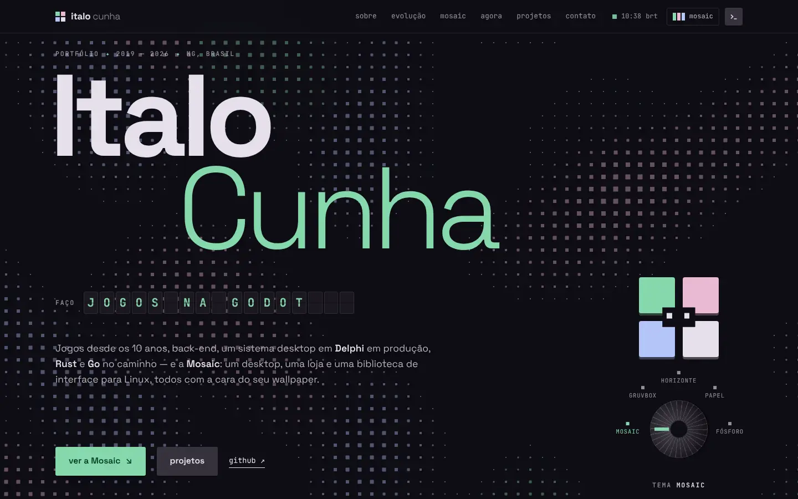
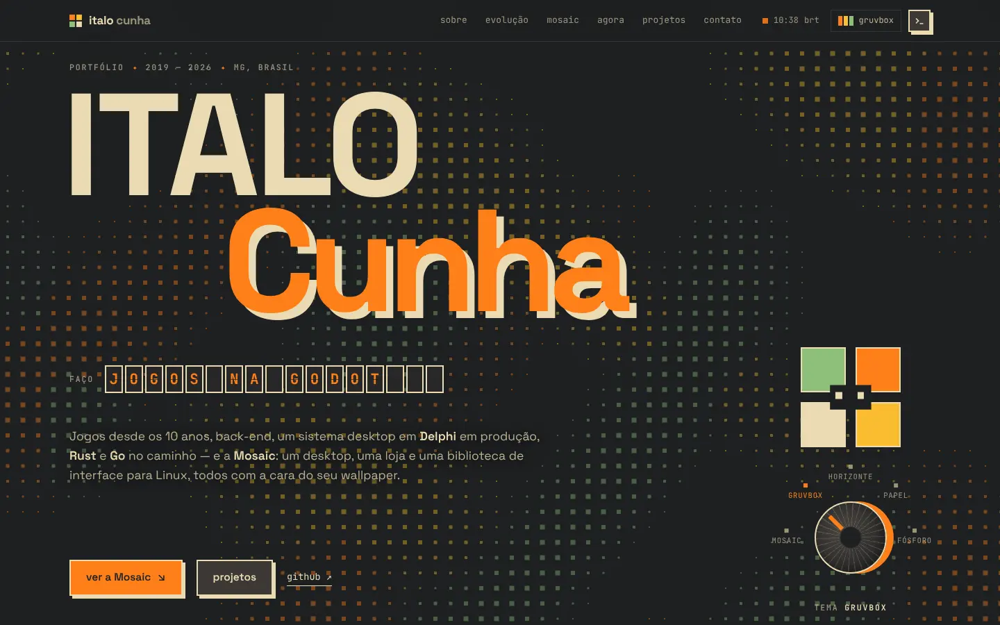
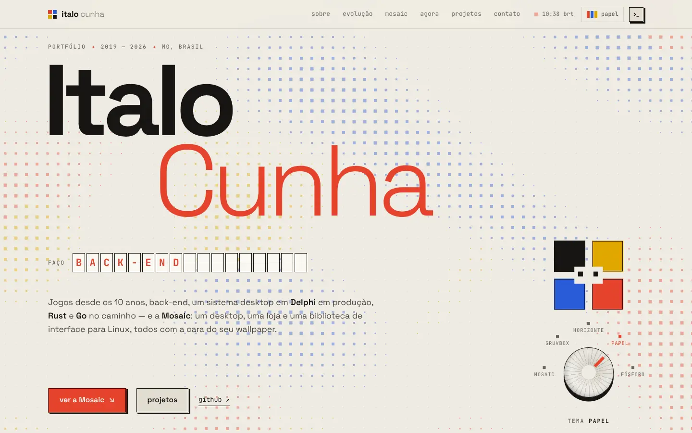
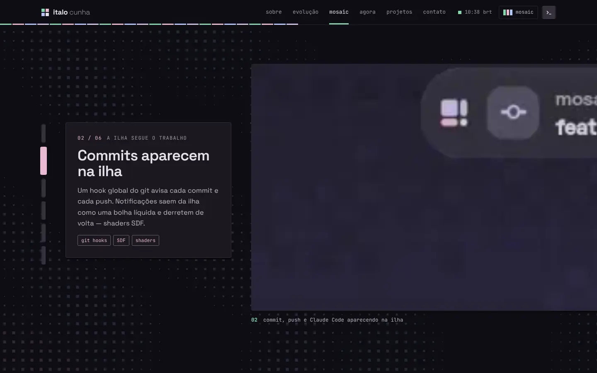
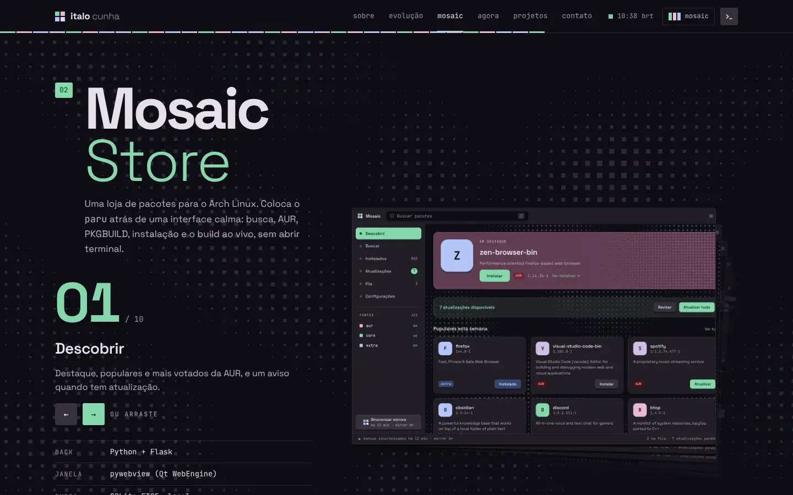
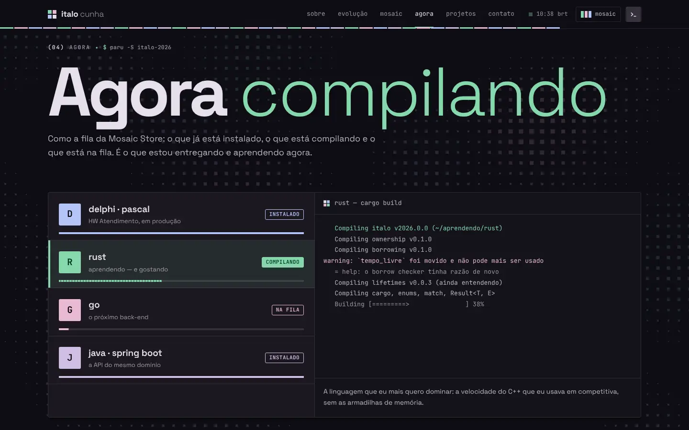
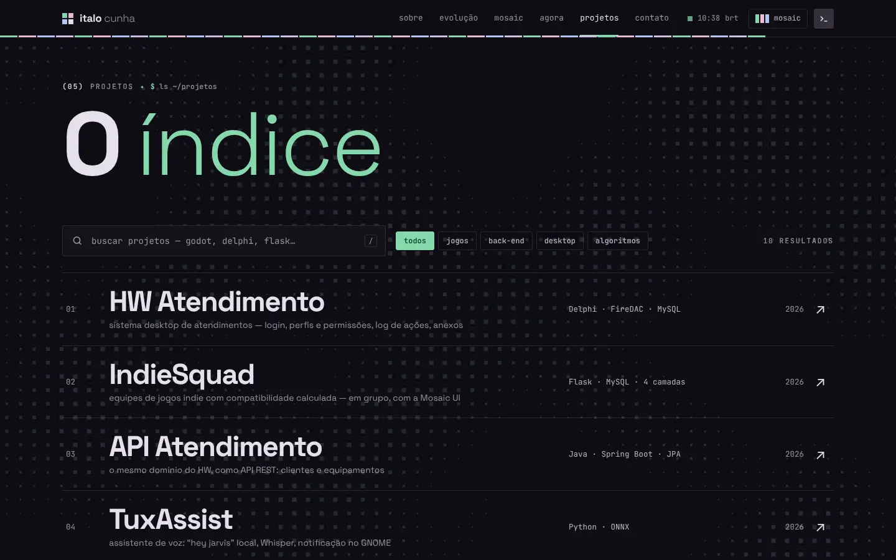

<div align="center">

# Portfólio — Italo Cunha

### Jogos, back-end, desktop e a Mosaic — num site em que o tema troca as cores *e* as formas.



🌐 **Versão publicada:** [portifolio.italocisarpinheiro.workers.dev](https://portifolio.italocisarpinheiro.workers.dev/)

</div>

> Escrito à mão em **HTML, CSS e JavaScript**, sem framework e sem build, com a estética da **[Mosaic UI](https://github.com/amendoa657/mosaicStore/tree/main/mosaic-ui)** — a identidade visual que eu criei para a Mosaic Store e o Mosaic OS.

## A ideia

Nada de cartão arredondado em grade. O site é editorial — tipografia enorme, linhas finas, índices — e cada seção tem o seu próprio **mostrador**:

| Seção | O mostrador |
| --- | --- |
| **Herói** | Um **letreiro de palhetas** (split-flap) troca o que eu faço, e um **botão giratório** escolhe o tema. O nome se monta em pixels. |
| **Quem sou** | Um manifesto com **peças** que caem no lugar, uma ficha técnica e **odômetros** que rolam dígito por dígito. |
| **Evolução** | A linha do tempo presa na tela, de 2019 até hoje, avançando com a rolagem. |
| **Mosaic OS** | Um **carrossel vertical**: os passos rolam, o palco fica preso à direita sangrando até a borda e troca numa onda de pixels. |
| **Mosaic Store** | Um **baralho** com as 10 telas da loja: clique, arraste ou use as setas — a carta nova nasce numa onda. |
| **Mosaic UI** | Os quatro pilares da identidade funcionando de verdade. |
| **Agora** | Uma **fila de compilação** como a da loja: Delphi instalado, Rust compilando, Go na fila, Spring Boot instalado. |
| **Projetos** | Um **índice** com busca (<kbd>/</kbd>), filtros e uma prévia que segue o mouse e se revela em pixels. |
| **Stack** | Um teclado: cada tecla mostra onde aquela tecnologia aparece. |

## Temas: cor e forma

Como no Mosaic OS, o tema não troca só a paleta:

| Tema | Como fica |
| --- | --- |
| **mosaic** | Os tons do wallpaper (Matugen), quinas quase retas, teclas que afundam. |
| **gruvbox** | Neo-brutalismo: caixa alta, bordas creme, sombra laranja dura. |
| **horizonte** | Pôr do sol dos anos 70: azul-marinho, laranja, traço fino e grão de filme. |
| **papel** | De dia: papel, tinta preta, vermelho e azul, sombra de carimbo. |
| **fósforo** | Um CRT verde: tudo em mono, brilho e linhas de varredura. |

| Gruvbox | Papel |
| --- | --- |
|  |  |

Troque pelo mostrador do herói, pelo botão do cabeçalho, pela tecla <kbd>W</kbd> ou pelo terminal (`tema fosforo`). A troca vem numa onda de pixels.

## Telas

| Mosaic OS | Mosaic Store |
| --- | --- |
|  |  |
| **Agora** | **Projetos** |
|  |  |

## Atalhos

| Tecla | O que faz |
| --- | --- |
| <kbd>1</kbd>–<kbd>6</kbd> | vai para a seção, numa onda de pixels |
| <kbd>Enter</kbd> / <kbd>P</kbd> / <kbd>G</kbd> | Mosaic / projetos / GitHub |
| <kbd>W</kbd> | próximo tema |
| <kbd>/</kbd> | busca nos projetos |
| <kbd>T</kbd> | terminal |
| <kbd>A</kbd> <kbd>S</kbd> <kbd>D</kbd> | aperta as teclas do pilar da Mosaic UI |
| <kbd>←</kbd> <kbd>→</kbd> | linha do tempo / baralho da Store (com foco) |

## Estrutura

```text
├── index.html
├── style.css           # cinco temas (cor + forma), componentes e layout
├── fontes/             # Space Grotesk e JetBrains Mono (SIL OFL 1.1)
├── img/  midia/        # linha do tempo, Mosaic, Mosaic OS e projetos
└── js/
    ├── pixels.js       # campo de pontos e onda de pixels (a conta da Mosaic UI)
    ├── tema.js         # os temas e a troca em onda
    ├── pixelTexto.js   # títulos que se montam em pixels
    ├── interface.js    # navegação, atalhos, odômetros, relógio, avisos
    ├── heroi.js        # letreiro de palhetas, mascote e mostrador
    ├── evolucao.js     # a linha do tempo
    ├── mosaic.js       # carrossel do OS, baralho da Store, pilares da UI
    ├── agora.js        # a fila de compilação
    ├── projetos.js     # índice, busca, prévia e teclado da stack
    ├── terminal.js     # o shell do painel lateral
    └── abertura.js     # a abertura
```

## Rodando localmente

```bash
python3 -m http.server 8000
```

Depois, abra [`http://localhost:8000`](http://localhost:8000).

## Créditos

- Estética, mascote e algoritmo dos pixels: [Mosaic UI](https://github.com/amendoa657/mosaicStore/tree/main/mosaic-ui) e [Mosaic OS](https://github.com/amendoa657/mosaicOS), projetos meus. O carrossel vertical do Mosaic OS veio de um conceito de site da própria Mosaic.
- Space Grotesk e JetBrains Mono, SIL Open Font License 1.1.
- Sobre IA: a direção de arte, as paletas, os layouts e o conteúdo são meus; boa parte do código foi escrita com a ajuda de IA.
